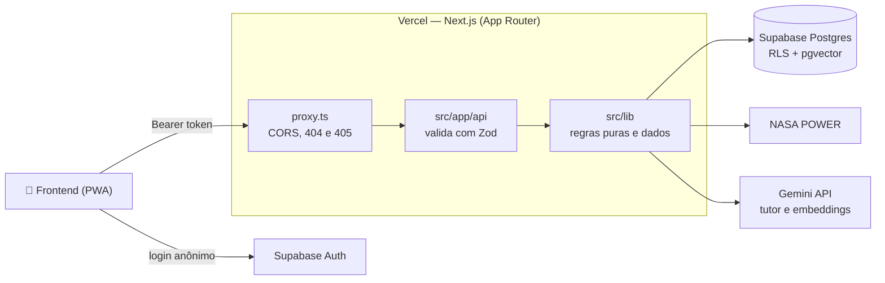

<div align="center">

# ⚡ Cidade Energia — Backend

<p align="center">
  <strong>"Sua conta de luz é a sua primeira aula de energia."</strong><br>
  API do app educacional <strong>Cidade Energia</strong>, criado no Hackathon Equatorial (Desafio 9) para estudantes de escolas públicas de São Luís (MA).
</p>

<p align="center">
  <a href="https://cidade-energia.vercel.app" target="_blank">
    
  </a>
  <a href="https://cidade-energia-back-end.vercel.app/api/docs" target="_blank">
    
  </a>
</p>

<p align="center">
  
  
  
  
  
  
  
  
  
</p>

[Visão Geral](#-visão-geral) •
[Deploy](#-deploy-em-produção) •
[Destaques](#-destaques-de-engenharia) •
[Arquitetura](#-arquitetura) •
[Como Rodar](#-como-rodar-localmente) •
[Guia da API](#-guia-da-api) •
[Testes](#-testes-e-verificação) •
[Roadmap](#-roadmap)

---

</div>

## 🎯 Visão Geral

O **Cidade Energia** ensina energia a partir de algo que todo estudante tem em casa: a conta de luz. Este repositório é **só o backend**; o [frontend](https://github.com/Coelho-G-Dev/Cidade-Energia-Front-End) é um PWA que consome as rotas abaixo.

| Módulo | O que a API entrega |
|---|---|
| 💡 **Simulador** | Gasto, economia, placas solares, retorno e CO₂ evitado, pela conta ou pelos aparelhos da casa, com prévia ao vivo |
| 📚 **Trilhas** | 5 trilhas, 18 lições em Markdown e 20 perguntas, concluídas na ordem |
| 🚲 **Pedale e veja** | Registro da atividade de gerar energia pedalando |
| 🌱 **Missões** | Hábitos marcados dia a dia, com as datas de cada noite feita |
| 🏆 **Pontos e conquistas** | Calculados só no servidor, sem duplicidade |
| 🗺️ **Rankings e mapa** | Ranking de bairros e escolas e 10 pontos de coleta reais de São Luís |
| ☀️ **Sol de hoje** | Quanto uma placa gera com o sol mais recente de São Luís (NASA POWER) |
| 🤖 **Tutor Energinho** | Tira dúvidas com base nas lições do app (RAG com Gemini) |

---

## 🌐 Deploy em Produção

O deploy é automático na **Vercel** a cada push no `master`.

- 📱 **App (frontend)**: [https://cidade-energia.vercel.app](https://cidade-energia.vercel.app)
- 🚀 **Base URL da API**: [https://cidade-energia-back-end.vercel.app](https://cidade-energia-back-end.vercel.app)
- 📖 **Swagger UI**: [https://cidade-energia-back-end.vercel.app/api/docs](https://cidade-energia-back-end.vercel.app/api/docs)
- 📄 **OpenAPI 3.1 (JSON)**: [https://cidade-energia-back-end.vercel.app/api/openapi](https://cidade-energia-back-end.vercel.app/api/openapi)

Para testar rotas com login no Swagger, clique em **Authorize** e cole um `access_token` ([como conseguir um](#como-conseguir-um-token-para-testes)).

Também há:

- [`docs/api.md`](docs/api.md): todas as rotas com exemplo de requisição e resposta;
- [`requests.http`](requests.http): chamadas prontas para o REST Client do VS Code. Preencha `@supabaseUrl` e `@anonKey` (a chave **pública**), rode "Login anônimo no Supabase" e troque `@baseUrl` pela URL de produção para testar o deploy. No JetBrains, cole o `access_token` em `@token`.

---

## ✨ Destaques de Engenharia

1. **Privacidade de menores de idade**: login anônimo, sem e-mail, telefone ou documento; só o primeiro nome, o bairro e a escola. O tutor não grava o texto das conversas, e o limite das rotas públicas guarda só um hash do IP.
2. **RLS em todas as tabelas**: cada estudante só lê os próprios dados. Pontos, respostas, progresso e uso do tutor são gravados só pelo servidor, com o `perfil_id` tirado do token.
3. **Pontos à prova de trapaça**: a tabela `pontos_eventos` é única por (perfil, origem, referência), e o cliente nunca envia pontos. As lições são concluídas na ordem, o quiz exige a lição concluída, e o gabarito nunca sai da API: errar trava a pergunta por 24 h sem revelar a correção.
4. **Rankings sem dados individuais**: saem de views agregadas. Só quem entra pelo código da turma soma pontos para a escola, o que impede que contas em massa inflem uma escola.
5. **Estimativas com fonte**: todas as constantes de cálculo ficam em `src/lib/config.ts`, cada uma com a fonte em `FONTES` (ANEEL, NASA POWER, MCTI, CRESESB, Greener).
6. **Resiliência**: a NASA POWER fica em cache (6 h para o dado diário, 30 dias para a média anual), com um valor de reserva se tudo falhar. O limite das rotas públicas fica no banco, porque cada chamada na Vercel pode rodar numa instância diferente.
7. **Erros padronizados**: toda resposta de erro, inclusive 404 e 405, segue `{ "erro": { "codigo", "mensagem" } }`, com a mensagem em português.

---

## 🏗️ Arquitetura



- As **rotas** só validam a entrada, chamam a lógica e respondem.
- As **regras de negócio** ficam em funções puras em `src/lib` (simulador, Sol de hoje, pontuação, ordem das lições, limites), todas com testes.
- O **banco** guarda as regras que precisam ser atômicas: RLS, funções SQL para pontos, trocas de bairro, limites e a busca vetorial do tutor.

---

## 🛠️ Stack Tecnológica

| Camada | Tecnologia |
|---|---|
| API | Next.js 16 (App Router) + TypeScript strict |
| Banco e login | Supabase: Postgres, Auth (login anônimo) e pgvector; migrations com a Supabase CLI |
| Validação | Zod 4 |
| IA | Gemini API (resposta do tutor e `gemini-embedding-2` de 768 dimensões, índice HNSW) |
| Dados de sol | NASA POWER (irradiação diária e média climatológica de São Luís) |
| Testes | Vitest |
| Deploy | Vercel |

---

## 📂 Estrutura do Repositório

```
src/app/api/           rotas (só validam, chamam a lógica e respondem)
src/lib/calculos/      funções puras do simulador e do Sol de hoje
src/lib/config.ts      constantes de cálculo e limites, com as fontes em FONTES
src/lib/dados/         acesso ao banco
src/lib/gamificacao/   regras puras de pontos, conquistas, quiz e ordem das lições
src/lib/ia/            Gemini, trechos, prompt do tutor e RAG
src/lib/nasa-power.ts  cliente da NASA POWER
src/lib/validacao/     schemas Zod
src/proxy.ts           CORS, 404 e 405 de todas as rotas /api
supabase/              migrations e seeds
scripts/               verificar-banco.mjs e indexar.ts
tests/                 testes Vitest
docs/api.md            guia das rotas com exemplos
```

---

## 💻 Como Rodar Localmente

Requisitos: **Node 24+** e um projeto Supabase com as migrations aplicadas.

```bash
npm install
cp .env.example .env.local
npm run dev
```

A API sobe em `http://localhost:3000`. Preencha o `.env.local` (peça as chaves a alguém do backend):

| Variável | Para quê |
|---|---|
| `NEXT_PUBLIC_SUPABASE_URL` | URL do projeto Supabase |
| `NEXT_PUBLIC_SUPABASE_ANON_KEY` | Chave pública (*publishable*). O front também usa esta |
| `SUPABASE_SERVICE_ROLE_KEY` | Chave secreta. **Só no servidor, nunca no front** |
| `GEMINI_API_KEY` | Chave da Gemini API (tutor e embeddings). **Só no servidor** |
| `GEMINI_MODEL` | Modelo que gera as respostas do tutor. Use `gemini-3.5-flash-lite` |
| `CORS_ORIGENS` | Endereços do front liberados no CORS, separados por vírgula (padrão `http://localhost:5173`) |

`CORS_ORIGENS` aceita vários endereços, por exemplo o front local, o deploy final e os previews da Vercel:

```bash
CORS_ORIGENS=http://localhost:3001,http://localhost:5173,https://cidade-energia.vercel.app,https://cidade-energia-*-sua-equipe.vercel.app
```

O `*` vale para um trecho do endereço, sem pontos, e serve para as URLs de preview da Vercel (`<projeto>-<hash>-<equipe>.vercel.app`). Termine o padrão com o nome da sua equipe, para não liberar projetos de outras pessoas. A lista é lida a cada requisição, então localmente basta salvar o `.env.local`. Na Vercel, uma variável alterada só vale para os deploys novos: depois de mudar, use **Redeploy** no último deploy (não precisa de commit novo).

---

## 🔐 Como Funciona o Login

O app não pede e-mail nem senha. Todo estudante entra com **login anônimo** do Supabase:

1. O front cria o cliente Supabase com a URL e a chave pública.
2. Nos botões "Criar meu perfil" **e** "Continuar sem perfil", chama `signInAnonymously()`.
3. Em toda chamada à API, envia `Authorization: Bearer <access_token>`.
4. "Criar meu perfil" = login + `PUT /api/perfil` com o primeiro nome e o bairro.

```ts
import { createClient } from "@supabase/supabase-js";

const supabase = createClient(SUPABASE_URL, SUPABASE_ANON_KEY);

const { data } = await supabase.auth.getSession();
if (!data.session) await supabase.auth.signInAnonymously();

async function api(caminho: string, init: RequestInit = {}) {
  const { data } = await supabase.auth.getSession();
  const token = data.session?.access_token;
  const resposta = await fetch(`${API_URL}${caminho}`, {
    ...init,
    headers: {
      "Content-Type": "application/json",
      ...(token ? { Authorization: `Bearer ${token}` } : {}),
      ...init.headers,
    },
  });
  const corpo = await resposta.json();
  if (!resposta.ok) throw corpo.erro;
  return corpo;
}
```

O supabase-js guarda a sessão e renova o token sozinho. Use sempre o token atual com `getSession()`.

**Não crie uma conta nova a cada visita.** Só chame `signInAnonymously()` quando `getSession()` não trouxer sessão, como no exemplo acima. Não chame `signOut()` ao fechar o app: isso faria o aparelho ganhar outra conta (e perder os pontos) na próxima visita.

### Proteção contra contas em massa (Cloudflare Turnstile)

Quando o CAPTCHA estiver ativado no Supabase (*Authentication → Attack Protection*), o login anônimo exige um token do Turnstile. O front mostra o widget e repassa o token:

```ts
await supabase.auth.signInAnonymously({ options: { captchaToken } });
```

- A **site key** do Turnstile vai no front; a **secret key** vai só no painel do Supabase (nunca no código).
- Com o CAPTCHA ativado, o `curl` abaixo e o `npm run verificar:banco` deixam de conseguir criar usuários. Rode a verificação antes de ativar, ou desative por alguns minutos para rodar.
- O MAC do aparelho não pode ser usado: o navegador não dá acesso a ele, e celulares trocam o MAC de propósito. Impressão digital do navegador também foi descartada: é pouco confiável e conta como dado pessoal de menores (LGPD, art. 14).

### Como conseguir um token para testes

Para usar o Swagger ou o Postman sem o front:

```bash
curl -X POST "$NEXT_PUBLIC_SUPABASE_URL/auth/v1/signup" \
  -H "apikey: $NEXT_PUBLIC_SUPABASE_ANON_KEY" \
  -H "Content-Type: application/json" \
  -d '{}'
```

Copie o `access_token` da resposta e cole em **Authorize** no Swagger. Ele vale por cerca de 1 hora.

---

## 📡 Guia da API

| Método | Rota | Login | O que faz |
|---|---|---|---|
| GET | `/api/bairros` | não | Lista os bairros |
| GET | `/api/escolas?bairro=<id>` | não | Lista as escolas (filtro por bairro opcional) |
| GET | `/api/aparelhos` | não | Lista os aparelhos do simulador |
| GET | `/api/perfil` | sim | Perfil do usuário logado (`tem_perfil` diz se já tem nome) |
| PUT | `/api/perfil` | sim | Cria ou atualiza o perfil |
| POST | `/api/simulacoes` | opcional | Simula a conta. Com login, salva a simulação |
| POST | `/api/simulacoes/previa` | opcional | Mesmo cálculo, sem salvar nem pontuar (estimativa ao vivo) |
| GET | `/api/simulacoes/ultima` | sim | Última simulação salva do usuário |
| GET | `/api/trilhas` | opcional | Lista as trilhas com o progresso do usuário |
| GET | `/api/trilhas/<slug>` | opcional | Trilha com a lista de lições |
| GET | `/api/licoes/<id>` | opcional | Conteúdo da lição (Markdown) |
| POST | `/api/licoes/<id>/concluir` | sim | Conclui uma lição de texto e pontua |
| GET | `/api/licoes/<id>/quiz` | opcional | Perguntas do quiz, **sem** a resposta certa |
| POST | `/api/quiz/responder` | sim | Corrige a resposta no servidor e pontua |
| POST | `/api/pedale/concluir` | sim | Registra o Pedale e veja e pontua |
| GET | `/api/missoes` | opcional | Lista as missões com o progresso |
| POST | `/api/missoes/<id>/registrar` | sim | Registra a missão no dia de hoje |
| GET | `/api/rankings?tipo=bairros\|escolas` | não | Ranking de bairros ou escolas |
| GET | `/api/mapa/pontos?tipo=solar\|coleta\|acao` | não | Pontos do mapa (filtro opcional) |
| GET | `/api/perfil/resumo` | sim | Pontos, trilhas, missões, conquistas e posição no ranking |
| GET | `/api/sol-de-hoje` | não | Quanto uma placa gera com o sol mais recente de São Luís |
| POST | `/api/tutor` | sim | Pergunta ao tutor Energinho |

"Opcional" quer dizer: sem token a rota funciona, mas o progresso vem zerado. Os detalhes de cada campo estão no Swagger. Os exemplos abaixo mostram os casos mais comuns.

### 👤 Criar o perfil

```http
PUT /api/perfil
Authorization: Bearer <token>

{ "primeiro_nome": "Ana", "bairro_id": "<id do bairro>", "escola_id": "<id da escola>" }
```

- Envie **só o primeiro nome** (sem sobrenome, sem espaços). O app não coleta e-mail, telefone nem documento.
- A escola é opcional. Envie `escola_id` (escolhida na lista) **ou** `codigo_turma` (passado pelo professor), nunca os dois.
- **Só quem entra pelo `codigo_turma` soma pontos para a escola** no ranking. Escolher a escola na lista mostra a escola no perfil, mas `escola_verificada` fica `false` e os pontos não contam para ela. Trocar de escola desfaz a verificação. Isso impede que contas criadas em massa inflem o ranking de uma escola sem o código da turma.
- **Limite de trocas:** o estudante pode trocar de bairro ou de escola **3 vezes a cada 30 dias**. Definir pela primeira vez, reenviar os mesmos valores ou mudar só o nome não conta. Acima do limite, a API responde `429 LIMITE_DE_TROCAS`, e a mensagem diz o dia e a hora em que a próxima troca será liberada.
- O `GET` e o `PUT /api/perfil` informam a situação das trocas, para o front avisar antes de o estudante tentar trocar:

  ```json
  { "limite_trocas": 3, "trocas_restantes": 0, "proxima_troca_em": "2026-11-14T18:30:00.000Z" }
  ```

  `proxima_troca_em` vem `null` enquanto houver trocas restantes.

### 💡 Simulador

Pela conta de luz (`valorConta` é opcional; sem ele, a API usa a tarifa padrão de São Luís):

```http
POST /api/simulacoes

{ "modo": "conta", "consumoKwh": 380, "valorConta": 312 }
```

Pelos aparelhos (use os `id`s de `GET /api/aparelhos` e o campo `horas_padrao` para pré-preencher o formulário; cada aparelho aparece uma vez só, e para dois ventiladores use `quantidade: 2`):

```http
POST /api/simulacoes

{
  "modo": "aparelhos",
  "itens": [
    { "aparelhoId": "<id do chuveiro>", "quantidade": 1, "horasDia": 0.5 },
    { "aparelhoId": "<id da geladeira>", "quantidade": 1, "horasDia": 24 }
  ]
}
```

Resposta:

```json
{
  "consumoKwh": 380,
  "gastoMensal": 312,
  "economiaMensal": 31.2,
  "placas": 6,
  "retornoAnos": 2.5,
  "co2EvitadoKgAno": 191.2,
  "pesos": [],
  "simulacaoId": null,
  "pontosGanhos": 0,
  "conquistasNovas": []
}
```

| Campo | Significado |
|---|---|
| `consumoKwh` | Consumo por mês (kWh) |
| `gastoMensal` | Quanto a família gasta por mês (R$) |
| `economiaMensal` | Quanto dá para economizar por mês mudando hábitos (R$) |
| `placas` | Quantas placas solares cobririam o consumo |
| `retornoAnos` | Em quantos anos as placas se pagam |
| `co2EvitadoKgAno` | CO₂ que as placas evitariam por ano (kg) |
| `pesos` | Quanto cada aparelho pesa na conta, em %. Vem preenchido só no modo `aparelhos` (do maior para o menor, somando 100) |
| `simulacaoId` | ID da simulação salva, ou `null` se não havia login |

Os números já vêm arredondados para exibir: R$ com 2 casas, o resto com 1. Todos são **estimativas didáticas**; mostre isso na tela.

#### Prévia ao vivo

Para a estimativa que muda a cada + ou −, use `POST /api/simulacoes/previa`, com o mesmo corpo e a mesma resposta. Ela **nunca salva** nem pontua, mesmo com token. Quando o estudante tocar em "Ver meu resultado", chame `POST /api/simulacoes` com token para salvar.

Limite de uso (`429 LIMITE_DE_REQUISICOES`):

- com token válido, a prévia conta por perfil: **120 a cada 10 minutos**;
- sem token, a prévia e o `POST /api/simulacoes` sem login dividem **600 por minuto por endereço de rede**. O teto é alto porque uma escola inteira pode sair pelo mesmo endereço. O banco guarda só um hash do endereço, nunca o IP.

Espere uns 400 ms depois do último toque antes de chamar a prévia.

### 📚 Trilhas, quiz e Pedale e veja

Fluxo sugerido de uma trilha:

1. `GET /api/trilhas` para montar a lista (com `licoesConcluidas` / `totalLicoes`).
2. `GET /api/trilhas/<slug>` para mostrar as lições. `liberada: false` marca as lições travadas.
3. `GET /api/licoes/<id>` para o conteúdo (Markdown) e `proximaLicaoId` para o botão "Próxima". Ler é sempre livre; `licaoPendente` diz qual lição anterior falta concluir.
4. Lição `tipo: "texto"`: ao terminar, `POST /api/licoes/<id>/concluir`.
5. Lição `tipo: "pedale"`: a atividade roda no front; ao terminar, `POST /api/pedale/concluir` com `{ "licaoId": "<id>" }`.
6. Se `totalPerguntas > 0`, **depois de concluir a lição**, `GET /api/licoes/<id>/quiz` e, para cada pergunta, `POST /api/quiz/responder`:

```http
POST /api/quiz/responder
Authorization: Bearer <token>

{ "perguntaId": "<id>", "opcao": 1 }
```

`opcao` é o índice da opção (0, 1, 2...). A resposta traz `correta`, `explicacao` (só quando a resposta está certa; `null` quando está errada), `pontosGanhos` e `proximaTentativaEm`.

**Ordem das lições:** dentro de uma trilha, a lição N só é concluída depois das anteriores. Pular a ordem dá `409 LICAO_BLOQUEADA`, e responder o quiz sem concluir a lição dá `409 LICAO_NAO_CONCLUIDA` (sem gravar a tentativa). Quem já tinha concluído fora de ordem mantém o progresso, os pontos e as conquistas.

**Regras do quiz:**

- Só a **primeira tentativa** vale pontos.
- Depois de errar, uma nova tentativa só vale pontos **24 horas depois** (`proximaTentativaEm`).
- Enquanto a nova tentativa não é liberada, a API responde `429 AGUARDE_NOVA_TENTATIVA` e não corrige a resposta. Assim o gabarito não pode ser descoberto testando as opções.
- Depois de acertar, o estudante pode responder de novo, mas não ganha pontos.
- Use `podePontuar` e `proximaTentativaEm` do `GET .../quiz` para desabilitar o botão e mostrar isso na tela.
- `licaoConcluida` no `GET .../quiz` diz se a lição já foi concluída. Enquanto for `false`, todas as perguntas vêm com `podePontuar: false`.

### 🌱 Missões

`GET /api/missoes` lista as missões. Cada dia em que o estudante cumpre a missão, o front chama `POST /api/missoes/<id>/registrar`:

- vale **um registro por dia** (fuso de São Luís); chamar de novo no mesmo dia devolve `novoRegistro: false`;
- `diasMarcados` traz as datas já registradas (`AAAA-MM-DD`, em ordem), para desenhar cada noite marcada. Vem no `GET /api/missoes` e também na resposta do registro, já com o dia de hoje;
- `trilhaSlug` liga a missão à trilha dela, para levar à missão prática no fim da trilha;
- quando `diasRegistrados` chega a `diasNecessarios`, a missão pontua uma vez só.

### 🏆 Pontos e conquistas

- Os pontos são calculados **só no servidor** e nunca duplicam: repetir uma ação devolve `pontosGanhos: 0`.
- Toda rota que pontua devolve `pontosGanhos` e `conquistasNovas`. Use `conquistasNovas` para mostrar a comemoração.
- `GET /api/perfil/resumo` traz o total de pontos e **todas** as conquistas, com `obtida: true/false`, para mostrar as bloqueadas.

| Ação | Pontos |
|---|---|
| Primeira simulação salva | 20 |
| Lição concluída | 10 |
| Resposta certa (que vale pontos) | 5 |
| Pedale e veja | 15 |
| Missão completa | definido em cada missão |

### 🗺️ Rankings e mapa

- `GET /api/rankings?tipo=bairros` ou `?tipo=escolas`: soma dos pontos de cada bairro ou escola, sem nenhum dado individual. Os pontos acompanham o bairro e a escola **atuais** do estudante. No ranking de escolas, só contam os estudantes com `escola_verificada` (entraram pelo código de turma). Só aparecem bairros e escolas com **pelo menos 1 ponto**; enquanto ninguém pontuar, a lista vem vazia.
- No `GET /api/perfil/resumo`, uma escola ou bairro que ainda não pontuou vem com `posicao: null` e `pontos: 0` (fora do ranking). `escola: null` significa que o estudante não informou escola.
- `GET /api/mapa/pontos` com `?tipo=solar`, `coleta` ou `acao` opcional: pontos com latitude e longitude. A descrição dos pontos de coleta diz o que cada um recebe e o horário.

### ☀️ Sol de hoje

`GET /api/sol-de-hoje` usa a irradiação diária da **NASA POWER** (parâmetro `ALLSKY_SFC_SW_DWN`) para São Luís:

```json
{
  "data": "2026-10-09",
  "irradiacao": 6.22,
  "kwhPorPlaca": 2.74,
  "horasArCondicionado": 2.7,
  "co2EvitadoKg": 0.105,
  "estimativa": true,
  "fonte": "nasa-power"
}
```

- Os dados da NASA chegam com **alguns dias de atraso**. `data` é o dia mais recente com medição nos últimos 10 dias. Mostre algo como "Sol de 09/10".
- `kwhPorPlaca` é o que uma placa de 550 Wp gera nesse dia. `horasArCondicionado` é por quantas horas essa energia liga o ar-condicionado do catálogo (1.000 W), e `co2EvitadoKg`, o CO₂ evitado nesse dia.
- `fonte` diz de onde veio o valor:
  - `nasa-power`: consultado agora;
  - `cache`: último valor guardado (o servidor consulta a NASA no máximo a cada 6 horas);
  - `config`: a NASA e o cache falharam, e o valor é a média anual de reserva (5,226). Nesse caso `data` vem `null`.

O simulador usa a **média anual climatológica** da NASA POWER para São Luís (2001–2025), também guardada em cache por 30 dias.

### 🤖 Tutor Energinho

```http
POST /api/tutor
Authorization: Bearer <token>

{
  "mensagem": "E quantas placas uma casa precisa?",
  "historico": [
    { "papel": "usuario", "texto": "Como a placa solar funciona?" },
    { "papel": "energinho", "texto": "A placa transforma a luz do sol em energia elétrica." }
  ]
}
```

```json
{
  "resposta": "Depende de quanto a sua casa gasta por mês...",
  "licoesRelacionadas": [
    { "id": "<id>", "titulo": "Quantas placas para a minha casa?", "trilhaSlug": "energia-solar-em-sao-luis" }
  ]
}
```

- O Energinho responde **só** sobre energia, conta de luz e sustentabilidade, com base nas lições do app (RAG). Quando não sabe, diz isso.
- O servidor **não grava o texto das conversas**. Para manter o contexto, o front guarda a conversa e envia as últimas mensagens (até 10) em `historico`.
- Limites: a `mensagem` pode ter até 500 caracteres; cada item do `historico`, até 1.000; a `resposta`, até 1.500. Cada estudante pode mandar **20 mensagens por hora**; acima disso, vem `429 LIMITE_TUTOR`, com o horário de liberação na mensagem.
- `licoesRelacionadas` pode vir vazia (por exemplo, numa pergunta fora do tema). Use `id` para abrir a lição.
- A `resposta` não cita títulos de lições: mostre `licoesRelacionadas` como links logo abaixo dela.

### ⚠️ Erros

Todo erro segue o mesmo formato, com o status HTTP correto:

```json
{ "erro": { "codigo": "ENTRADA_INVALIDA", "mensagem": "consumoKwh: O consumo deve ser maior que zero." } }
```

A `mensagem` está em português e pode ser mostrada ao usuário. Use o `codigo` para decidir o que fazer:

| Status | Código | Quando |
|---|---|---|
| 400 | `ENTRADA_INVALIDA` | Algum campo inválido (a mensagem diz qual) |
| 400 | `JSON_INVALIDO` | O corpo não é um JSON válido |
| 400 | `REFERENCIA_INVALIDA` | Algum ID enviado não existe |
| 400 | `LICAO_E_PEDALE` | Tentou concluir uma lição de Pedale pela rota de lição de texto |
| 400 | `LICAO_NAO_E_PEDALE` | Mandou uma lição de texto para `/api/pedale/concluir` |
| 401 | `NAO_AUTENTICADO` | Sem token ou token inválido: faça o login anônimo de novo |
| 404 | `PERFIL_NAO_ENCONTRADO` | Perfil não encontrado |
| 404 | `TURMA_NAO_ENCONTRADA` | Código de turma não existe |
| 404 | `BAIRRO_OU_ESCOLA_NAO_ENCONTRADO` | Bairro ou escola não existe |
| 404 | `APARELHO_NAO_ENCONTRADO` | Algum aparelho da simulação não existe |
| 404 | `NENHUMA_SIMULACAO` | O usuário ainda não salvou nenhuma simulação |
| 404 | `TRILHA_NAO_ENCONTRADA` | Trilha não existe |
| 404 | `LICAO_NAO_ENCONTRADA` | Lição não existe |
| 404 | `PERGUNTA_NAO_ENCONTRADA` | Pergunta não existe |
| 404 | `MISSAO_NAO_ENCONTRADA` | Missão não existe |
| 404 | `ROTA_NAO_ENCONTRADA` | A rota não existe |
| 405 | `METODO_NAO_PERMITIDO` | A rota existe, mas não aceita esse método (veja o cabeçalho `Allow`) |
| 409 | `LICAO_BLOQUEADA` | Tentou concluir uma lição antes das anteriores da trilha (a mensagem diz qual falta) |
| 409 | `LICAO_NAO_CONCLUIDA` | Tentou responder o quiz antes de concluir a lição |
| 429 | `LIMITE_DE_TROCAS` | Já trocou de bairro ou escola 3 vezes nos últimos 30 dias |
| 429 | `AGUARDE_NOVA_TENTATIVA` | Errou a pergunta e as 24 h para a nova tentativa ainda não passaram |
| 429 | `LIMITE_TUTOR` | Já mandou 20 mensagens ao tutor na última hora |
| 429 | `LIMITE_DE_REQUISICOES` | Muitas simulações seguidas (prévia ou simulação sem login): espere um pouco |
| 500 | `ERRO_INTERNO` | Erro inesperado: tente de novo |
| 503 | `TUTOR_INDISPONIVEL` | O serviço de IA não respondeu: tente de novo em alguns minutos |

Campos que a API não conhece são recusados com `400`. Por exemplo, o front **nunca** envia pontos: eles são calculados só no servidor.

---

## 🗃️ Dados e Conteúdo

- **Dados de exemplo** (ilustrativos): 12 bairros de São Luís, 6 aparelhos e 3 escolas fictícias com os códigos de turma `SOL2026`, `VENTO26` e `LUZ2026`.
- **Conteúdo** (5 trilhas, 18 lições, 20 perguntas e 2 missões): revisado em 2026-10-17. Os números das lições são **estimativas didáticas** e usam as mesmas constantes do simulador (`src/lib/config.ts`).
- **Mapa** (14 pontos): os **10 pontos de coleta são locais reais** de São Luís (ecopontos da Prefeitura, a Central de Logística Reversa da Vila Isabel e a UFMA), conferidos em 2026-10-17, com o que cada um recebe e o horário na descrição. Os 2 pontos solares e as 2 ações ainda são ilustrativos e não correspondem a locais reais.

**Sempre que o conteúdo das lições mudar:**

1. Reaplique o seed com `npx supabase db query --linked -f supabase/seeds/conteudo.sql`. O `db push --include-seed` **não** reexecuta um seed que já foi aplicado: ele só atualiza o hash e deixa o texto antigo no banco. O seed só faz upserts, então os ids, o progresso e os pontos de quem já usou o app continuam valendo.
2. Rode `npm run indexar` para o tutor usar o texto novo.

---

## 🧪 Testes e Verificação

```bash
npm test                  # 257 testes Vitest, sem banco e sem APIs externas
npx tsc --noEmit          # tipos
npm run lint              # ESLint
npm run verificar:banco   # checagens no Supabase real
```

- Os **testes Vitest** cobrem as funções puras (simulador, Sol de hoje, pontuação, quiz, ordem das lições, limites), as rotas, a camada de dados com um Supabase simulado e a especificação OpenAPI (toda rota existente precisa estar documentada).
- O **`verificar:banco`** confere no Supabase real o RLS com dois usuários, os grants, o gabarito escondido e as funções SQL. Com `API_URL` definida, testa também as rotas e o fluxo completo (simular → concluir lição → quiz → ranking da escola). Cria usuários anônimos de teste e apaga todos no fim.

```bash
API_URL=https://cidade-energia-back-end.vercel.app npm run verificar:banco
```

---

## 📦 Scripts Disponíveis

| Comando | O que faz |
|---|---|
| `npm run dev` | Sobe a API em `http://localhost:3000` |
| `npm test` | Roda os testes (Vitest, sem banco e sem APIs externas) |
| `npx tsc --noEmit` | Checa os tipos |
| `npm run lint` | Roda o ESLint |
| `npm run build` | Build de produção |
| `npm run indexar` | Divide as lições em trechos, gera os embeddings no Gemini e regrava `documentos_rag` |
| `npm run indexar -- --simular` | Só mostra os trechos, sem chamar o Gemini nem gravar no banco |
| `npm run verificar:banco` | Confere o banco e as permissões no Supabase real (e as rotas, com `API_URL`) |
| `npx supabase migration new <nome>` | Cria uma migration |
| `npx supabase db push` | Aplica as migrations no projeto ligado (`--include-seed` para os seeds novos) |
| `npx supabase db query --linked -f supabase/seeds/conteudo.sql` | Reaplica o conteúdo das trilhas depois de editá-lo |

---

## 🧭 Decisões

- **Login anônimo + Bearer token.** O front é outra aplicação, então não há cookies. O token é validado com `auth.getClaims()`.
- **Dados mínimos de estudantes**, que podem ser menores de idade: só o primeiro nome, o bairro e a escola. Sem e-mail, telefone ou documento.
- **RLS em todas as tabelas.** O cliente só lê os próprios dados. Pontos, respostas, progresso, cache e uso do tutor são gravados só pelo servidor, com o `perfil_id` tirado do token.
- **Pontos sem duplicidade:** a tabela `pontos_eventos` é única por (perfil, origem, referência). O cliente nunca envia pontos.
- **Rankings** saem de views agregadas, sem dados individuais, e só mostram quem tem pelo menos 1 ponto.
- **Lições na ordem:** concluir uma lição exige as anteriores da trilha, e o quiz exige a lição concluída. Ler continua livre. Assim não dá para juntar pontos pulando a leitura.
- **Limite nas simulações:** fica no banco (`consumir_limite_publico`), porque cada chamada na Vercel pode rodar numa instância diferente. A chave é um HMAC do IP ou o ID do perfil. Se o banco falhar, a rota segue sem limite e registra o erro.
- **Estimativas:** todas as constantes do simulador ficam em `src/lib/config.ts`, com a fonte em `FONTES`. A tarifa padrão é a B1 da Equatorial Maranhão sem tributos (R$ 0,8888/kWh), dado público homologado pela ANEEL.
- **NASA POWER:** a irradiação diária fica em cache por 6 horas, e a climatologia, por 30 dias; uma falha também conta como tentativa, para não sobrecarregar a API; se a NASA e o cache falharem, a API usa a média anual do config.
- **Tutor:** embeddings `gemini-embedding-2` de 768 dimensões, no pgvector com índice HNSW; um trecho entra no contexto se tiver similaridade de pelo menos 0,62 e ficar a no máximo 0,08 do mais parecido (valores calibrados com perguntas reais); a geração usa o modelo de `GEMINI_MODEL`, chamado por REST, sem SDK.
- **Privacidade no tutor:** o texto das conversas não vai para o banco nem para os logs. `tutor_uso` guarda só o momento de cada mensagem, para o limite por hora.
- **Erros padronizados:** todas as respostas de erro, inclusive 404 e 405, seguem `{ "erro": { "codigo", "mensagem" } }`.

---

## 🔮 Roadmap

- [ ] Ativar o **CAPTCHA (Cloudflare Turnstile)** no login anônimo, quando o front enviar o `captchaToken`.
- [ ] Trocar os **códigos de turma** do seed por códigos aleatórios para as escolas reais.
- [ ] Incluir a **Ripel Reciclagem** no mapa, quando houver a coordenada exata, e trocar os pontos solares e as ações ilustrativos por locais reais.
- [ ] Exigir um **mínimo de participantes** por escola no ranking, para não expor a soma de um único aluno.
- [ ] **Limpeza automática** dos usuários anônimos inativos.
- [ ] Mostrar o **acréscimo da bandeira tarifária** no simulador.

---

## 📬 Contato

Projeto desenvolvido para o **Hackathon Equatorial (Desafio 9)**.

📍 **São Luís, MA · Brasil 🇧🇷**

<p align="left">
  <a href="mailto:gabrielbiellosousa@gmail.com">
    
  </a>&nbsp;
  <a href="https://www.linkedin.com/in/gabriel-coelho-7184a32a3/" target="_blank">
    
  </a>&nbsp;
  <a href="https://github.com/Coelho-G-Dev" target="_blank">
    
  </a>
</p>
